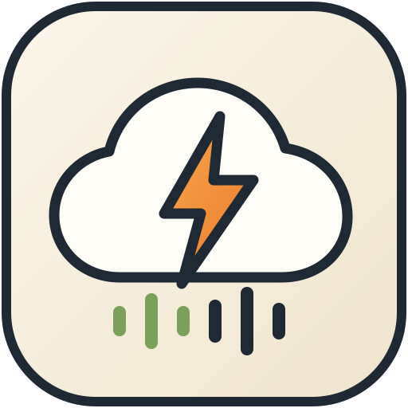
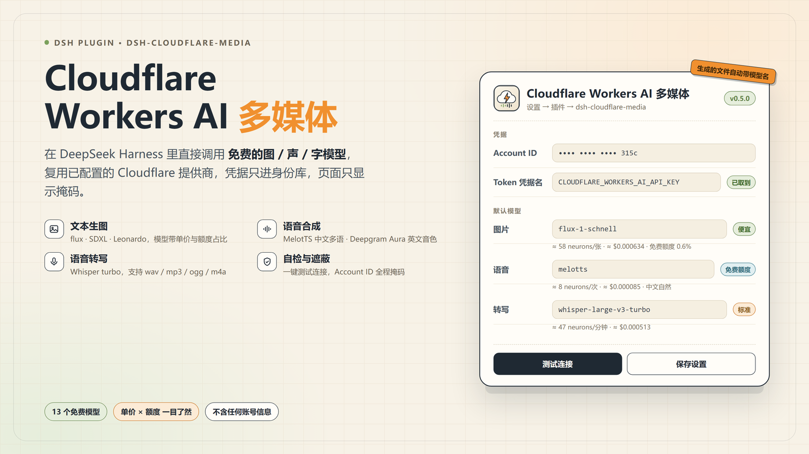

<p align="center">
  
</p>
# dsh-cloudflare-media

为 DeepSeek Harness 补上 **Cloudflare Workers AI** 的多媒体能力：文本生图、文本转语音、语音转文字，外加一个可用的图形设置页。

作者：**稻米鼠** · 仓库：[dmscode/dsh-cloudflare-media](https://github.com/dmscode/dsh-cloudflare-media)

Workers AI 的多媒体模型走 `POST /accounts/{account}/ai/run/{model}` + `Authorization: Bearer <token>`，和 OpenAI 兼容的 `chat/completions` 不是一条路，所以 `dsh-llm-pi-ai` 的文本通道覆盖不到。本插件把这条通道包成 4 个模型工具，并把「账号 / 令牌 / 三个默认模型 / 输出」放进 Harness 的插件设置页。

**分发包里不含任何账号或令牌**：Account ID 与 API Token 由每位使用者在设置页填写，落在本机 DSH 凭据库，页面只显示掩码。



## 工具

| 工具 | 作用 | 默认模型 |
| --- | --- | --- |
| `cloudflare_generate_image` | 文生图 / 图生图（SD 系列支持 `image` 输入） | `@cf/black-forest-labs/flux-1-schnell` |
| `cloudflare_text_to_speech` | 文本转语音，返回音频文件路径 | `@cf/myshell-ai/melotts` |
| `cloudflare_speech_to_text` | 本地音频转文字（Whisper） | `@cf/openai/whisper-large-v3-turbo` |
| `cloudflare_media_status` | 诊断：账号来源、凭据、端点、模型清单 | — |

设置页下拉框会列出下列模型，每个模型下方直接显示 **官方单价 + 单次估算 + 消耗档位**；也允许直接填写任意 `@cf/...` ID。

| 类型 | 模型 | 官方单价（neurons） | 档位 |
| --- | --- | --- | --- |
| 文生图 | `@cf/black-forest-labs/flux-1-schnell` | 4.8/512² tile + 9.6/step（1024² 四步 ≈58） | 便宜 |
| 文生图 | `@cf/bytedance/stable-diffusion-xl-lightning` | $0.00/step（Beta 期免费） | 免费 |
| 文生图 | `@cf/lykon/dreamshaper-8-lcm` | $0.00/step（Beta 期免费） | 免费 |
| 文生图 | `@cf/stabilityai/stable-diffusion-xl-base-1.0` | $0.00/step（Beta 期免费） | 免费 |
| 文生图 | `@cf/leonardo/lucid-origin` | 636/512² tile + 12/step（1120² 默认 ≈5,820，占免费额度 58%） | **很贵** |
| 文生图 | `@cf/leonardo/phoenix-1.0` | 530/512² tile + 10/step（1024² ≈2,200，占 22%） | 偏贵 |
| 文生图 | `@cf/runwayml/stable-diffusion-v1-5-img2img` | Beta 期免费 | 免费（免费账号常 403） |
| 语音合成 | `@cf/myshell-ai/melotts` | 18.63/音频分钟 | 便宜 |
| 语音合成 | `@cf/deepgram/aura-1` | 1,363.64/千字符 | 标准 |
| 语音合成 | `@cf/deepgram/aura-2-en` / `aura-2-es` | 2,727.27/千字符 | 标准 |
| 语音识别 | `@cf/openai/whisper-large-v3-turbo` | 46.63/音频分钟 | 便宜 |
| 语音识别 | `@cf/openai/whisper` | 41.14/音频分钟 | 便宜 |

免费额度：**每天 10,000 neurons**（UTC 00:00 重置），超出部分 $0.011/千 neurons（Workers Paid）。Cloudflare 没有公开的「当日余额/剩余额度」REST 接口，实际用量在 Dashboard → Workers AI 查看（程序化统计可走 GraphQL Analytics，需 `Account Analytics:Read` 权限）；插件只在设置页列出各模型的官方单价与单次估算，不显示余额。

> 生成的文件名里带模型名，例如 `cloudflare-image-forest-labs-flux-1-schnell-20261023-111749-8b973d.jpg`、`cloudflare-speech-myshell-ai-melotts-20261023-111919-06cc44.wav`，一眼能看出是哪个模型产的。

## 安装

```text
plugin_manager  action=install_bundle  target=github:dmscode/dsh-cloudflare-media   # 从 GitHub 安装
plugin_manager  action=install_bundle  target=<本目录的绝对路径>                       # 本地开发
```

安装后在 **设置 → 插件 → dsh-cloudflare-media** 打开本插件的页面：

1. 填 **Account ID**（32 位十六进制，Cloudflare 控制台右下角；也可点「自动发现」，前提是 Token 带 `Account:Read`）；
2. 填 **API Token**（Workers AI 权限即可）；
3. 三个能力的 **默认模型** 按下拉框选（每个选项下方标了价格与消耗档位）；
4. 点「保存设置」，再用「测试连接」确认。

> 浏览器半侧（`lib/client.js`）在 Harness 启动时进入前端插件图。若安装/更新后插件页没有出现配置卡片，重启一次 Harness（关掉再打开）即可；之后改 `lib/client.js` 会由 HMR 热替换。

### 手动挂载

```powershell
cmd /c mklink /J "%USERPROFILE%\.dsh\profiles\desktop\node_modules\dsh-cloudflare-media" "<本目录>"
```

包自带 `cordis.patch.yml`，插件管理器安装时会自动插入 `cloudflare-media` 这一行；手动挂载时把该文件内容追加到 profile 的 `cordis.patch.yml` 即可。

## 设置页

页面挂在插件页的 bundle 配置槽位（`plugins.bundle.config`，key 为包名），分四块：

1. **连接** — Account ID（掩码显示、可自动发现）、API Token（只显示「已保存」，不回传明文）、凭据名提示、连接测试（返回延迟与账号名；若 Token 只有 Workers AI 权限、读不到账号资料，会自动改用一次最便宜的推理请求验证连通性，并说明原因）；
2. **默认模型** — 生图 / 语音合成 / 语音转写三行，下拉选目录内模型或「自定义…」填任意 `@cf/...`；
3. **输出** — 输出目录、是否保存到会话工作区；
4. **高级** — 请求超时、API 基址、令牌凭据名。

保存位置与优先级：

- **凭据**（Account ID、API Token）写入 DSH 凭据库的 `CLOUDFLARE_ACCOUNT_ID` 与 `CLOUDFLARE_WORKERS_AI_API_KEY`，和 Cloudflare 文本模型共用同一份；HTTP 接口只回掩码或「是否已配置」。
- **普通设置**写入 `<DSH_HOME>/cloudflare-media/settings.json`（Windows 默认 `C:\Users\<you>\.dsh\cloudflare-media\settings.json`）。
- 生效顺序：设置页 › 插件 `config`（部署级）› 内置默认值。

页面通过宿主半侧的 4 个同源 JSON 路由读写（`/cloudflare-media/api/settings` 的 GET/PUT、`credentials`、`discover`、`test`），写操作要求 `x-dsh-cloudflare-media: 1` 请求头并做字段校验，浏览器无法直接接触凭据存储。

## 部署级配置（可选）

无图形界面（headless、CI、容器）时，可在 profile 的 `cordis.patch.yml` 里给这一行写配置：

```yaml
- id: cloudflare-media
  name: dsh-cloudflare-media
  config:
    imageModel: '@cf/black-forest-labs/flux-1-schnell'
    outputFolder: media/generated
```

| 键 | 默认 | 说明 |
| --- | --- | --- |
| `accountId` | 空 | 部署级兜底 Account ID；公开分发时留空，交给设置页 |
| `apiTokenEnv` | 空 | 凭据名；留空沿用 provider 的 `apiKeyEnv`，最终默认 `CLOUDFLARE_WORKERS_AI_API_KEY` |
| `imageModel` / `speechModel` / `transcriptionModel` | 空 | 留空则用设置页的值 |
| `outputFolder` | `cloudflare-media` | 落盘子目录（相对工作目录） |
| `saveToWorkspace` | `true` | 关闭后图片仍附到对话，音频改写到系统临时目录 |
| `requestTimeoutMs` | `120000` | 单次请求超时 |
| `baseURL` | 空 | 覆盖 API 根地址（代理、网关） |

工具参数里的 `model` 仍可临时覆盖默认模型。

## 凭据解析顺序

API Token：设置页凭据名 → Cloudflare provider 的 `apiKeyEnv` → `CLOUDFLARE_WORKERS_AI_API_KEY` → 同名环境变量。

Account ID：设置页保存的 `CLOUDFLARE_ACCOUNT_ID` 凭据 → `config.accountId` → provider 的 `accountId` → provider `baseURL` 里的 `/accounts/<id>/` 段 → 环境变量 → 凭据库中 kind 为 `api-key` 的记录 → Token 仅可见唯一账号时自动采用。

## 行为细节

- **生图**：兼容 `{result:{image:"<base64>"}}` 与 `{result:{images:["<base64>"]}}`；支持 `steps`、`seed`、`negative_prompt`、`width`/`height`（非 flux 模型才发尺寸与负提示词，`steps` 映射为 `num_steps`）；SD 系列可传工作区图片路径作为 `image` + `strength` 做图生图。结果经附件服务渲染成对话图片，按 `saveToWorkspace` 决定是否落盘。
- **TTS**：`melotts` 用 `prompt` + `lang`；`aura-*` 用 `text` + `voice`；其他模型回退到 `text` + `voice` + `lang`。TTS 按调用的接口自动探测音频类型（`content-type` → 魔数 → wav），mp3/wav 都能正确落盘。
- **ASR**：上传本地音频（≤ 25 MB，与 Whisper 上限一致），依次尝试 multipart、裸二进制、JSON base64，任一成功即返回。
- **免费额度**：Workers AI 免费层按 Neurons 计（约 10000/天），耗尽后返回 429/400，插件原样带出 `errors[].message`。

## 安全

- Account ID 与 Token 只存在 DSH 凭据库；插件不打印、不写入 settings.json、不通过 HTTP 回传明文（页面与 `cloudflare_media_status` 都只显示末 4 位）。
- 写接口要求自定义请求头并逐字段校验（模型必须以 `@cf/` 开头、Account ID 必须 32 位十六进制、超时 1000–600000 ms、输出目录不允许 `..` 与绝对路径）。
- 只请求解析出的 Workers AI 端点，或你显式配置的 `baseURL`。
- 生成文件只写工作目录下的 `outputFolder` 或系统临时目录，文件名 = `<前缀>-<模型名>-<时间戳>-<随机串>.<扩展名>`。

## 分发

```powershell
npm pack          # 生成 dsh-cloudflare-media-<version>.tgz，只含 lib/、cordis.patch.yml、README、LICENSE
```

对方拿到后两种装法：

```text
plugin_manager action=install_bundle target=<tgz 的本地路径>
plugin_manager action=install_bundle target=<npm 包名或 git 地址>
```

装完重启一次内核（宿主半的 HTTP 路由与槽位在启动时才注册），然后在 **设置 → 插件 → dsh-cloudflare-media** 填自己的 Account ID 与 Token 凭据名即可。包里不含任何账号、Token 或本机路径。

## 开发

```powershell
node --check lib/index.js; node --check lib/http-api.js; node --check lib/settings-store.js; node --check lib/client.js
node test-catalog.mjs    # 离线：模型目录结构与价格换算（改目录后必跑）
node test-settings.mjs   # 离线：设置存储、校验、掩码与 HTTP 路由
node test-smoke.mjs      # 离线：mock ctx + mock fetch，校验 4 个工具与返回结构
```

- `lib/catalog.js` **模型目录与价格的唯一来源**（见下节，改模型只动这里）；
- `lib/index.js` 宿主半：纯 ESM，第三方运行时依赖只有可选的 `schemastery`；
- `lib/http-api.js` 设置页的后端路由（Node `(req,res)`）；
- `lib/settings-store.js` 设置文件与优先级；
- `lib/client.js` 浏览器半：`window.__ModuleLoader__.load({ id, factory })`，`require('react')`，无构建步骤。

改宿主半后需要重新启用插件让新代码生效；改 `lib/client.js` 由 HMR 热替换。

品牌资产在 `assets/`：图标源文件 `icon.svg`（派生 `icon-1024/512/256/128/64.png`，透明底），封面源文件 `cover.html`（派生 `cover-2x.png` 3200×1800 与 `cover-1600x900.png`）。**别用 `msedge --screenshot` 出图**——Windows 缩放会让视口按设备像素算，右、下两边被静默裁掉；用 CDP 固定布局视口再截图：

```powershell
node assets/render.mjs assets/icon.svg.html assets/icon-1024.png 512 512 2
node assets/render.mjs assets/cover.html assets/cover-2x.png 1600 900 2
```

```powershell
plugin_manager action=set_plugin target=include:cloudflare-media enabled=false
plugin_manager action=set_plugin target=include:cloudflare-media enabled=true
```

## 维护模型目录

Cloudflare 的模型与 neuron 单价会变，所以它们全部集中在 `lib/catalog.js`，不在其它文件里出现第二份：

1. **加/删/调模型**：改 `MODEL_CATALOG.image | speech | transcription`，每个模型一个对象（`id`、`note`、`tier`、`price`）。
2. **改单价**：模型条目里的 `price`（neuron 数）与 `usd*`（官方美元价）一起改；若 neuron→美元汇率或免费额度变了，改 `PRICING`。
3. **加档位**：在 `TIERS` 里加一项，并在 `lib/client.js` 加一条 `.cfm-tier.t-<tone>` 颜色规则。
4. **改默认模型**：改 `DEFAULTS`。
5. 跑 `node test-catalog.mjs`：校验 id 唯一、tier 存在、price 形状合法、默认模型在目录内、每种价格都能正确换算。

设置页、状态工具、文件名中的模型短名、单价行与估算行都从这份目录派生；目录写坏时 `cloudflare_media_status` 会直接列出校验失败项。

```powershell
node --check lib/index.js; node --check lib/http-api.js; node --check lib/settings-store.js; node --check lib/client.js
node test-settings.mjs   # 离线：设置存储、校验、掩码与 HTTP 路由
node test-smoke.mjs      # 离线：mock ctx + mock fetch，校验 4 个工具与返回结构
```

- `lib/index.js` 宿主半：纯 ESM，第三方运行时依赖只有可选的 `schemastery`；
- `lib/http-api.js` 设置页的后端路由（Node `(req,res)`）；
- `lib/settings-store.js` 设置文件与优先级；
- `lib/client.js` 浏览器半：`window.__ModuleLoader__.load({ id, factory })`，`require('react')`，无构建步骤。

改宿主半（前三者）后需要重新启用插件让新代码生效；改 `lib/client.js` 由 HMR 热替换。

```powershell
plugin_manager action=set_plugin target=include:cloudflare-media enabled=false
plugin_manager action=set_plugin target=include:cloudflare-media enabled=true
```

## 兼容性与已知限制

- 已在 DSH 桌面版（2026-10 构建）、Node.js 24.21、Windows 11 上完整验证：四个工具、设置页、5 类错误路径。
- 宿主半只依赖公开的插件 API（`tools`、`attachments`、`credentials`、`webServer`、`configEditor`、`systemPrompt`）。
- 浏览器半依赖 DSH 前端的扩展点（`window.__ModuleLoader__`、`slots.register('plugins.bundle.config')`）；这些不是长期稳定契约，升级 DSH 后若设置卡片消失，先看 README 的“开发”一节重启内核，再核对槽位名。
- Cloudflare 没有余额查询 API；`0.011 USD/千 neurons` 与 10,000 neurons/天免费额度写死在 `lib/catalog.js` 的 `PRICING` 里，官方调价后改这一处并跑 `node test-catalog.mjs`。
- 语音文件以路径形式返回，不会作为附件内嵌。
- `stable-diffusion-v1-5-img2img` 需要账号已开通，部分免费账号返回 403。
## License

MIT
